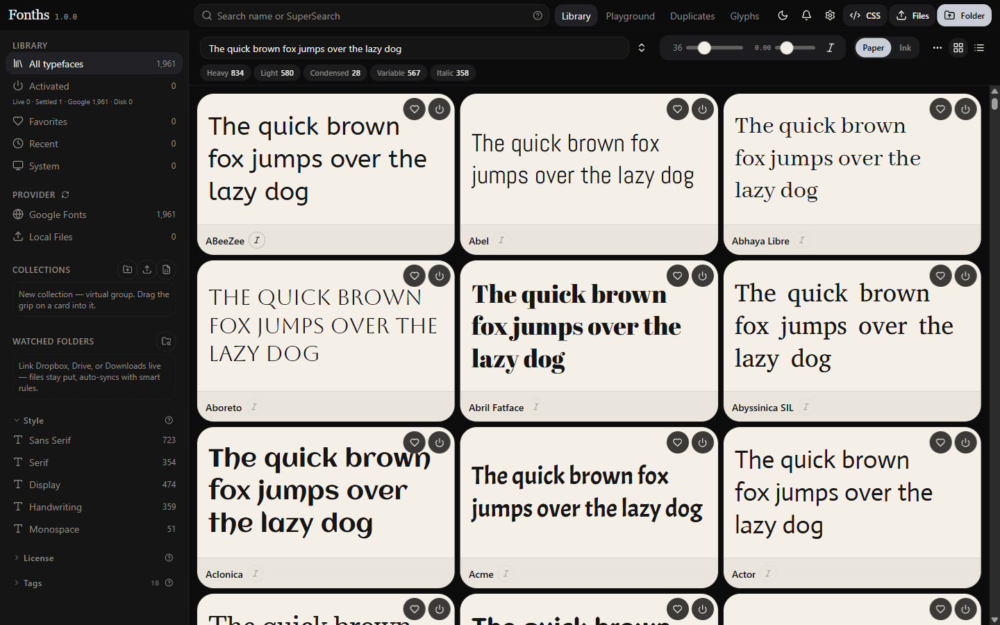
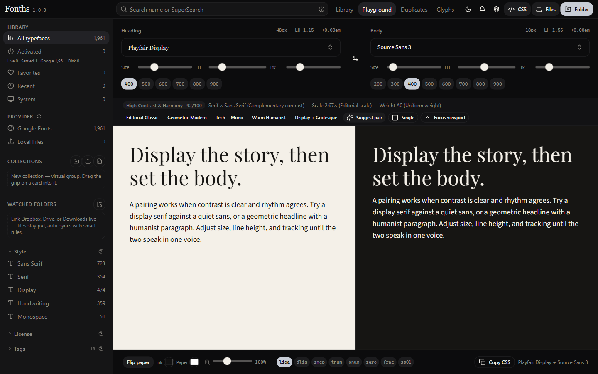
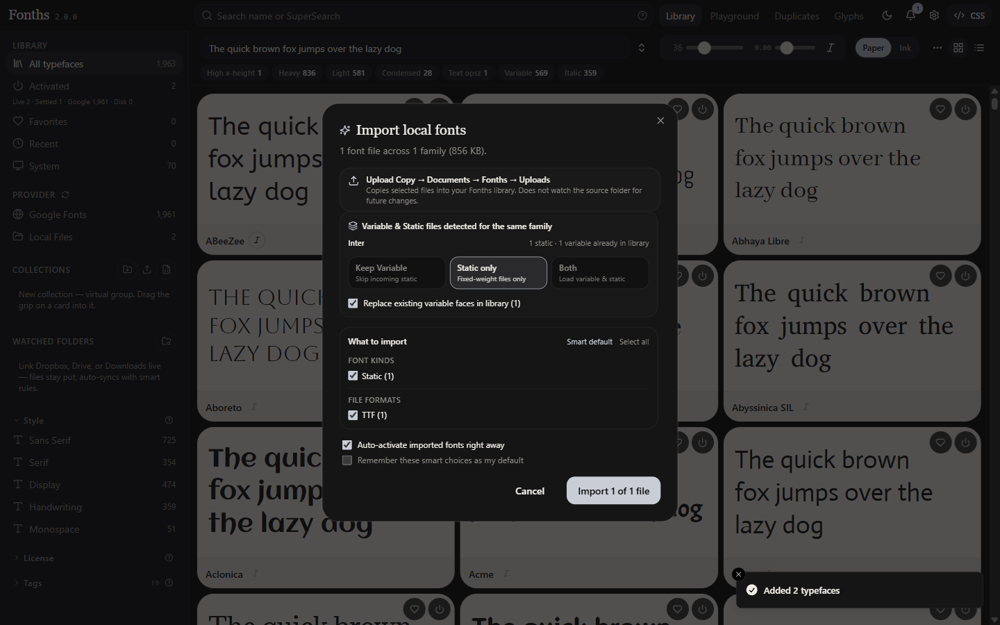
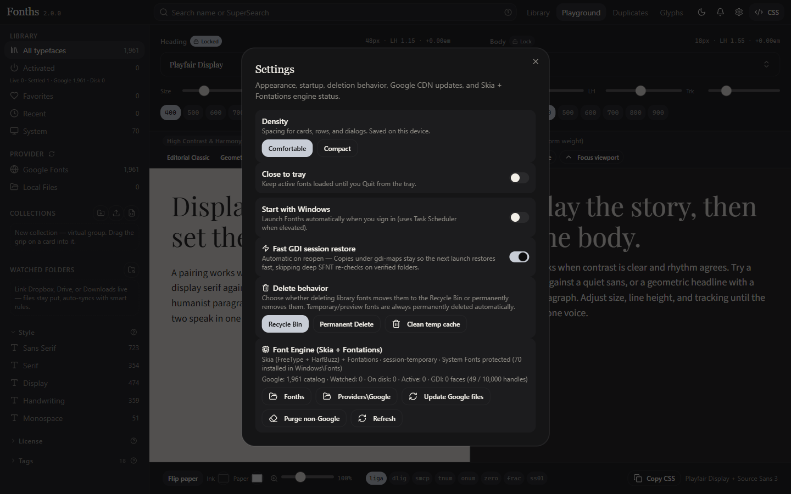

# Fonths 2.2.2

A high-performance, cross-platform-ready Windows desktop font manager built with **Tauri v2 (Rust)**, **100% pure-Rust Google Fontations (`read-fonts` + `skrifa`) + `harfrust` + `tiny-skia`**, **`rayon`**, a **zero-copy `font://` custom URI protocol**, a **~6 MB pure-Rust headless tray daemon (`--daemon`)**, and **React 19**. Scan, inspect, preview with 100% OpenType fidelity, organize, and temporarily activate Google Fonts and local typefaces in **Adobe Photoshop / Illustrator / InDesign, Microsoft Word, Affinity, and Figma**—**without permanently installing them into `C:\Windows\Fonts`**.

Active fonts use **temporary system-wide Win32 Session Table activation** (`AddFontResourceExW` with `FONT_RESOURCE_CHARACTERISTICS(0)` + coalesced `SendNotifyMessageW(HWND_BROADCAST, WM_FONTCHANGE)`) backed by **zero-copy NTFS hardlink staging** under `%LOCALAPPDATA%\Fonths\gdi-maps`, with diff-based HKCU session sync and automatic teardown on Quit so `C:\Windows\Fonts` stays completely untouched.

---

## Core Architecture (v2.2.2)

- **Zero-Copy OpenType Scanner (`src-tauri/src/scanner.rs` & `parse.rs`):** Uses **Google Fontations (`read-fonts 0.47`) + `memmap2` + `rayon`** (plus pure-Rust `wuff` for `.woff2`) across all CPU cores to scan `.ttf`, `.otf`, `.ttc`, and `.woff2` files and read-only OS system fonts (`C:\Windows\Fonts`) without OS installation—extracting names, `fvar` axes + `STAT` overlays, full `cmap` glyphs, `OS/2` metrics, and deduplicated GSUB/GPOS OpenType features (`liga`, `dlig`, `ss01–ss20`, `smcp`, `onum`, `tnum`, `zero`, `kern`, etc.).
- **Pure-Rust Fontations + HarfRust Specimen Renderer (`src-tauri/src/renderer.rs`):** Zero C++ dependencies (no `skia-safe`, no GDI rendering, no DirectWrite). Uses `read_fonts::model::Font`, `harfrust 0.16` (pure-Rust HarfBuzz shaping for all OpenType features & scripts), `skrifa 0.50` (hinted/unhinted variable outline scaling), and `tiny-skia 0.12` (anti-aliased RGBA8888 output), returning raw pixel buffers over `tauri::ipc::Response` with latest-wins per-slot coalescing directly into the **Font Inspector** `<canvas>`.
- **Zero-Copy `font://` Custom URI Protocol (`src-tauri/src/font_protocol.rs`):** Asynchronous Tauri URI scheme backed by an LRU `memmap2` cache + `rayon` I/O pool streaming local font bytes straight into WebView2 `@font-face` / `FontFace` with automatic mmap eviction before file deletion.
- **Two-Process Headless Rust Tray Daemon (`src-tauri/src/daemon.rs`):** Default-ON background mode (`fonths.exe --daemon`, toggleable in Settings) boots before WebView2 (~6–10 MB RAM), restores saved session fonts at Windows login when Start Minimized is enabled, keeps active fonts live when the UI window closes (exiting WebView2 for zero idle browser RAM), and hands active sessions back to the UI in **< 20 ms** on reopen.
- **Fast Win32 Session Table Activation (`src-tauri/src/activate.rs` & `session_stage.rs`):** NTFS hardlink staging (0 bytes copied on same volume), diff-based HKCU registry batch sync, Variable-TTF-first policy with 1-click **Optimize Library** and opt-in **Prefer static fonts (compatibility mode)** toggle in Settings, and strict honest live progress counts.

---

## Screenshots

### Library & Google Fonts


### Live Typography Playground


### Smart Local Font Import (Variable vs. Static & Format Filtering)


### Settings & Fontations + HarfRust Engine


---

## Highlights

- **Headless Rust Daemon & Instant Reopen (< 20 ms):** Closing the window hands active fonts off to the ~6 MB pure-Rust daemon and exits WebView2; reopening adopts the daemon's live Win32 Session Table immediately without re-scanning or re-registering. On cold boot, the sidebar shows real progressive live counts matching Win32 registration.
- **Pure-Rust Fontations + HarfRust + `font://` Protocol (59% Smaller Binary):** Dropped C++ `skia-safe` (~23.5 MB → ~9.5 MB `fonths.exe`, ~5.8 MB NSIS installer) while keeping 100% OpenType GSUB/GPOS shaping, live variable font axes, synthetic oblique, letter spacing, and line height.
- **Atomic Bulk Google Fonts Activation & 1-Click Library Optimization:** Ships `1,961` Google Fonts (`567` variable) out of the box, prioritizes `selected → favorites → visible → first-page → recent`, uses NTFS hardlinks + Variable TTFs for 4–8× faster activation, and offers **Settings → Optimize Library** (plus **Prefer static fonts** for legacy app compatibility).
- **In-Place Watched Folders & Smart Duplicate Protection:**
  - `Documents\Fonths\Providers\Google` — Downloaded Google Fonts catalog (with live CDN revision sync & **Purge non-Google** cleanup)
  - **Watched Folders** — Strictly in-place external folders (Dropbox, Drive, Downloads) with within-folder deduplication, Variable/Static prompts, family collision handling, and signature-tracked skipping so skipped duplicates never re-toast on background polls.
- **Full SuperSearch & Live Typography Studio:**
  - **SuperSearch:** Supports quoted phrases, `-negation`, `weight:>=700`, `axis:slnt`, `ot:smcp` / `has:liga`, `category:icons`, `license:open`, `xh:`, `contrast:`, live intersected chip counts, and clickable `axis:` / `ot:` chips inside the Inspector.
  - **Live Playground:** Lockable `Suggest pair`, Split/Single viewports, variable axes, Ink/Paper pickers, zoom, and OpenType feature pills.
  - **Font Inspector & Glyphs:** Fontations + HarfRust live `<canvas>` specimen, instant OS/2 + GSUB/GPOS inspection, variable/weight/italic/tracking/leading sliders, character map, and license details.
  - **Duplicates Finder & Smart Deletion:** `O(N)` duplicate detection with **Auto-hide & deactivate duplicates**, configurable **Recycle Bin** vs. **Permanent Delete**, and automatic `font://` mmap eviction before unlink.

---

## Font Engine Comparison: FontBase vs. MainType vs. NexusFont vs. Fonths

| Architecture Dimension | FontBase | MainType (High-Logic) | NexusFont | **Fonths 2.2.2** |
| --- | --- | --- | --- | --- |
| **Runtime & UI** | Electron (Chromium + Node.js) | Native C++ / Win32 + `FmsService` | Native Delphi / Win32 | **Tauri v2 (Rust) + Pure-Rust Fontations/HarfRust + ~6 MB Headless Daemon + React 19** |
| **Watched / Local Folders** | Copies or links into `~/FontBase`; `Providers/Google` | SQLite vault + synced disk folders | In-place folder references | **Strictly in-place Watched Folders + `Providers\Google` + 1-click VF Optimize** |
| **Idle Background RAM** | ~150–300+ MB (Electron stays open) | Background Windows service | Tray Win32 app | **~6–10 MB pure-Rust tray daemon (WebView2 exits on close)** |
| **Bulk Activation & Staging** | Direct `AddFontResourceExW` batch | Service-managed transactional batch | Batched `AddFontResourceExW` + `WM_FONTCHANGE` | **Zero-copy NTFS hardlink staging + `rayon` parallel scan + diff-based HKCU sync + 1 `WM_FONTCHANGE`** |
| **Metadata & Rendering** | FreeType / JS parser | Native SFNT + SQLite cache | GDI / FreeType | **Zero-copy `read-fonts` + `skrifa` + `harfrust` + `tiny-skia` + zero-copy `font://` protocol** |

---

## Development & Building (Windows)

### Prerequisites
- **Node.js** `>= 22`
- **Rust** stable (`msvc` toolchain, `>= 1.87`) + **Tauri v2** prerequisites (WebView2, WiX / NSIS for installers)

### Commands
```powershell
npm install
npm run typecheck
npm run lint
npm test
cargo test --manifest-path src-tauri/Cargo.toml --locked
npm run build
npm run test:e2e
npm run test:desktop
```

### Build Windows Installers (NSIS & MSI)
```powershell
npx tauri build
```
Installers are written to:
- `src-tauri/target/release/bundle/nsis/Fonths_2.2.2_x64-setup.exe`
- `src-tauri/target/release/bundle/msi/Fonths_2.2.2_x64_en-US.msi`

See [docs/ARCHITECTURE-2.0.0.md](docs/ARCHITECTURE-2.0.0.md) for historical architecture notes.

---

<details>
<summary><strong>Architecture Reference & Historical Engineering Log</strong></summary>

## Three words that must stay honest

| Word | Means | Does not mean |
| --- | --- | --- |
| **Library** | The file is in the catalog or on disk. | Word can use it. |
| **Settled** | We already know this Windows session will refuse it (hard list: Gidugu), or a soft font was tried and Add returned 0. | It is activated. |
| **Live** | `AddFontResourceExW` returned a number greater than 0 in this session (or held by the live headless daemon). | The file exists, a download finished, or a `.complete` file is present. |

## Where the code lives

| Path | What it is |
| --- | --- |
| `src/routes/` | Library `/`, Playground, Glyphs, Duplicates. |
| `src/components/font-studio/` | Grid, Inspector, Playground, Smart Import, Download Bar, Notification Center, Settings. |
| `src/lib/fonts/` | Store, activation bridge (`os-activate.ts`), watched folders (`watch-folder.ts`), smart import analysis (`import-options.ts`), SuperSearch (`metrics.ts`, `search-index.ts`), virtual windowing. |
| `src-tauri/src/` | Pure-Rust engine: `lib.rs`, `daemon.rs`, `font_protocol.rs`, `scanner.rs`, `renderer.rs`, `activate.rs`, `activator.rs`, `parse.rs`, `fast_parse.rs`, `google_cdn.rs`, `delete_ops.rs`, `namepatch.rs`, `session_stage.rs`. |
| `scripts/*.test.mjs` | Automated unit & live WebView2 CDP E2E test suites (`npm test`, `npm run test:e2e`, `npm run test:desktop`). |

UI stack: React 19, Vite, TanStack Router, Zustand, Tailwind CSS. Desktop: Tauri v2, Rust, Google Fontations (`read-fonts` + `skrifa`), `harfrust`, `tiny-skia`, `rayon`, `memmap2`.

## API (what the window can ask Rust to do)

The web build does not have these. They exist only in the desktop window.

**Session**

| Command | Plain meaning |
| --- | --- |
| `set_session_families` / `session_families` | Remember which families should come back next launch. |
| `session_boot_state` | What was actually registered at startup. |
| `set_desktop_prefs` | Close-to-tray and start-with-Windows. Both default off. X means quit. |

**Library files**

| Command | Plain meaning |
| --- | --- |
| `activation_folder` / `open_activation_folder` | The Documents folder. |
| `save_library_file` / `install_font_file` | Write an uploaded font into that folder. |
| `remove_library_file` / `uninstall_font_family` | Remove a file or a family. |
| `scan_disk_families` | Read what is already on disk. |
| `prune_unknown_folders` | Move unknown folders to the Recycle Bin. Never on a silent boot. |

**Activate**

| Command | Plain meaning |
| --- | --- |
| `register_font_path` | Add one file. Refuses `C:\Windows\Fonts`. |
| `register_existing_on_disk` / `activate_families_on_disk` | Register families that are already downloaded. |
| `list_activated_families` / `font_family_installed` | What this process has Added. |
| `unload_font_family` / `unload_font_families` | Remove. The count returned is how many were actually unloaded, not “you clicked.” |
| `flush_font_cache` | Legacy. Do not call on quit. |

**Catalog download**

| Command | Plain meaning |
| --- | --- |
| `plan_google_activation` | Decide which files a family still needs. |
| `start_google_downloads` | Begin the queue. |
| `pause_google_downloads` / `resume_google_downloads` | Hold between faces, then continue. Does not restart at 0. |
| `cancel_google_downloads` | Stop after the current face. |
| `google_download_progress` | The full progress snapshot, including every ready name. |
| `drop_google_download_families` / `skip_google_failures` | Take families off the queue. Must not wipe unrelated pending work. |
| `retry_google_downloads` / `repair_incomplete_families` | Try again. Repair is for short or unmarked folders. |
| `resolve_family_fetch_intent` | Google or Fontsource. Never guess Google after a Fontsource card. |
| `try_fontsource_gdi_offer` | Optional second source after a soft refuse. Live only if Add > 0. |
| `clear_session_gdi_refused_family` | Allow one retry in this run. |
| `read_family_font` | Bytes for the inspector when the file is local. |

**Documents refresh**

| Command | Plain meaning |
| --- | --- |
| `sync_documents_vf_policy` | Walk Documents. If a variable font is intact and already Added, drop the redundant statics. |
| `cancel_documents_refresh` | Its own cancel flag. Not the download cancel. |

**Read a font**

| Command | Plain meaning |
| --- | --- |
| `parse_font_layout` / `parse_family_layout` | Axes, names, metrics. |
| `parse_font_cmap` / `parse_family_cmap` | Which characters exist. |
| `index_font_paths` | Index a watched folder. |
| `hash_bytes` / `hash_font_path` / `diff_font_bytes` | Duplicates. |
| `list_system_fonts` / `open_system_fonts_folder` | What Windows already installed. View only. |

Progress also arrives as a `font-download` event. While the job is running that event’s name list may be only the new tail. The poll is the full list. The UI merges them in `absorbReadyNames`. A later cleanup is to send an explicit “this is a tail” or “this is the full list” instead of guessing. Do not do that in the same week as the Windows test.

## Open bugs (do not invent fixes for the ones that are unproven)

| # | What | How to know it is fixed |
| --- | --- | --- |
| 1 | The stall fix (20s lookup, 300s file, per-face label, short progress events) is on `main` and on the website. The Windows app already on the PC does not update from the website. | Install a build of `0d2da47` or later and watch a full catalog run. |
| 2 | Boot migration, delete one family, and TTC activation are fixed in source and tests. Not watched on a real library. | Do those three on the PC. Files must not disappear. |
| 3 | Installer “please close” is source-only. It must not force-kill, and it must not touch `\Tip\`. | Run the installer once against a normal window, and once with a Tip build open. |
| 4 | Cancel during a big file still waits for that file (up to 300s). | Expected until a later cancel design. The label should name the face. |
| 5 | The UI guesses whether a name list is a tail or the full list. A shorter restart that starts with the same family can keep stale names until the next full poll. | After the Windows test, add an explicit kind. Do not rip out the full-list poll. |
| 6 | Kappa Text missing from a 20-file upload was not reproduced. | Leave it unless you can show the miss. |
| 7 | No code signing. SmartScreen will warn. | A real certificate, which this repo does not invent. |
| 8 | PR #77 is still open and would replay an old branch onto a main that has moved. | Close it. Do not merge it. |

## Already fixed — do not do these again

Dark “Clear uploads” contrast (`#a84a3b` on `#f2efe8`). Latin samples for Poppins, Rubik, and Noto Sans when the font actually has Latin. First paint no longer reads `sessionStorage` (that was React hydration error #418). The migration marker is written only when nothing was kept back and nothing errored. Non-ASCII family names do not collapse to “sans.” `Library` and `u-` folders are not migrated. CI does not persist checkout credentials. The website header shows `1.0.207` and the commit when the host provides one.

## Optimizations (and the trap in each)

| Idea | Do it? | If you do it carelessly |
| --- | --- | --- |
| More than 2 download workers | No | Deadlock. Workers and stream slots are matched at 2. |
| Shorter than 300s on the font file | No | A large font becomes a false failure, then Repair loops. |
| 20s on the small lookup | Already on | A slow but alive metadata server marks the family incomplete. Repair is the recovery. Do not also cut the file timeout. |
| Skip static files before the variable font has Added | No | If the variable Add fails you have nothing to fall back to. |
| Send only new names, forever | No | The idle event and the poll must still send the full list. |
| Byte counter inside the download | Later | Google files are buffered so the name can be patched before the file is published. Printing bytes must not rename the file early, and must not change “428 / 1,946.” |
| One Rust job object for download, Add, and Repair | Later, as one design | Six small patches to the same file is how 1.0.206a–ag happened. |

## Improvements that are allowed later

After the Windows test, in this order:

1. Say in the event whether the name list is a tail or the full snapshot.
2. Show megabytes for the current file, throttled to about twice a second, without a second “done” count.
3. Only then consider a per-file job list, a resume manifest, and mid-file cancel. A resume marker must not trust a half-written file or a `.complete` that was written too early.

Not on the list: a third provider, accounts, or a new activation API.

## Conflicts (change this, and that breaks)

| If you change… | You also break… |
| --- | --- |
| Family count into a face count | Every “1,946” label, the confirm dialog, and the percent. |
| Live to mean “file exists” | The Settled badge, the toast, and the Activated filter. |
| Google and Fontsource into one fetch | Fontsource cards start hitting Google and trip the circuit breaker. |
| Add on the Documents path | Delete and Repair fail because Windows holds the file. |
| Writing `.u-folders-v1` when a conflict was kept | The next boot thinks the move finished and a file is gone. |
| `taskkill` or killing `\Tip\` | A reviewer’s running build dies, and the installer test becomes a lie. |
| The first-paint theme or tab list | React #418 comes back on the website. |
| `done/total` to include skipped | The bar shows a number bigger than the total (this already happened once). |

## Deploy

| Where | How | What updates |
| --- | --- | --- |
| Website | Merge to `main`. Vercel builds it. | The look book and the web half of the progress UI. Not the Windows timeouts. |
| Windows installer | On the PC: `deploy.bat`. Output under `Desktop\Vibe Apps\Font Manager\Installers\`. | The real app. Node 22 and the Visual C++ build tools once. First Rust compile is slow. |
| GitHub release | Do not, until the Windows test passes. | A release is a promise. `v1.0.206` is the last promise. |

`desktop-setup.bat` only opens a dev window. It does not build a setup. `fix-install.bat` is for a setup that will not uninstall. This tree cannot produce the installer.

## Screenshots

The Windows pictures are from the installed app, so the letters are real Windows text. The website pictures are the current catalog (`1.0.207`).

| Library (Windows) | Inspector |
| --- | --- |
|  |  |

| System fonts | Variable slider |
| --- | --- |
|  |  |

| Playground (Windows) | Variable facet |
| --- | --- |
|  |  |

**Website** — CSS only, no Word:

| Catalog | Glyphs |
| --- | --- |
|  |  |

| Playground | Duplicates |
| --- | --- |
|  |  |

| Phone |
| --- |
|  |

## Install on Windows

1. Install [Node.js 22 LTS](https://nodejs.org).
2. Unzip or clone so `deploy.bat` sits next to `package.json`. A folder named `font-manager-main (1)` is fine.
3. Double-click `deploy.bat` and leave it open: pack the UI, compile Rust, write the installer.
4. Run the setup from `Desktop\Vibe Apps\Font Manager\Installers\`.
5. If an old setup fights you, run `fix-install.bat`. Unblock the file in Properties if Windows marks it as downloaded.

MSI needs WiX v3. The NSIS setup does not. WebView2 is included if the PC does not have it.

## License

[LICENSE](LICENSE).

---

## Letter-tip archive

The notes below are history. Tests still search this file for them, so they stay here. Where they mention a system-wide Escape shortcut, hiding the library, or `data-fm-cancel-seq`, **1.0.207 replaced that**. A copy with the same warning is [docs/LETTER-TIPS.md](docs/LETTER-TIPS.md).

## Letter-tip history

Notes from **1.0.206** through **1.0.206ag** stay below so older reviews can find them. Where they mention a system-wide Escape shortcut, pointerdown cancel, hiding the library, or `data-fm-cancel-seq`, **1.0.207 replaced that**. They are not the live behavior.

**1.0.206ag (Eric GO via Skye — native Escape must abort mid-Refresh).** Live 206af: Escape SendKeys into WebView never armed cancel; UIA often blind; job finished → Anti-PASS refreshed toast. Fix: **`tauri-plugin-global-shortcut` Escape** registered only while Rust `docs_vf_session_live` (bypass WV); tray Cancel + Esc accel → `request_docs_vf_cancel_native`; immediate `bulk().cancel`; keep HOLD (no bare Stopping); UIA labelledby + unnamed chrome. ProductVersion **1.0.206**. No tip-install/pack.

**1.0.206af (Eric GO via Skye — Escape/tray must abort mid-job).** Live 206ae: hung=False (throttle OK) but FromPoint still blind; Escape at +5.4s after settle → success toast; Inter static=0. Fix: `docsVfSyncSessionLive` from Refresh arm until sync finally (Escape works during Scanning); tray emits `docs-vf-cancel-requested` → same JS arm/toast; UIA Name = visible label + `aria-labelledby` (no title/valuenow/description; no named chrome region). Keep 206ae throttle + 206ad IPC/teardown/honesty. **HOLD amend:** no bare `|stopping` in docs current belt (Activate Stopping… ≠ documents-refresh). ProductVersion **1.0.206**. No tip-install/pack.

**1.0.206ae (Eric GO via Skye — keep WebView responsive mid-Refresh).** Live 206ad: visual Cancel present but UIA FromPoint/FindFirst blind; mouse lost race → success toast; mid-spray (Not Responding). Progress emits ~350ms starved pump. Fix: docs VF emit ≥**900ms** + every **48** dirs; stable `Refreshing Documents (n/N)` (no per-family text); no `preventDefault` on pointerdown/mousedown; Escape + tray **Cancel Documents refresh** set `bulk().cancel`. Keep 206ad immediate IPC + deferred teardown + honesty. ProductVersion **1.0.206**. No tip-install/pack.

**1.0.206ad (Eric GO via Skye — mouse Cancel must abort mid-job).** Live 206ac: hang fixed, but Invoke fails mid-refresh and mouse (~8s) lost the race → success or late-cancel toast; Inter fully purged. Fix: **pointerdown/mousedown** arms sticky pending + Cancelling + **immediate** `cancel_google_downloads` IPC (teardown still `setTimeout(0)` for Invoke hang fix); click no-ops if armed; Rust cancelable purge + `cancelled:true` if flag set after last dir; success path re-checks pending before toast; seq via **`title`/`aria-description`** (`fm-cancel-seq=N`) for HelpText. ProductVersion stays **1.0.206**. No tip-install/pack this tip.

**1.0.206ac (Eric GO via Skye — Cancel must not hang WebView; cancelled toast).** Live 206ab: InvokePattern SUCCESS mid-job, Inter statics kept (purge interrupted), but WebView **hung** (`responding=False`) and toast stayed **Refreshing Documents folder…** — never **Documents refresh cancelled**. Root cause: UIA Invoke blocks the UI thread until the click handler returns; sync job teardown/`emit` during Invoke froze the WebView so `await syncDocumentsVfPolicy()` never settled. Fix: docs Cancel does **minimal sync work** (sticky pending + seq + replace Refreshing→**Cancelling…**) then **`setTimeout(0)` teardown + cancel IPC**; toast **cancelled/late before rescan**; Rust skips progress emits after cancel. Keeps 206ab chrome-forced sticky, cancel-seq, FindFirst inert, async cmds. ProductVersion stays **1.0.206**. No tip-install/pack this tip.

**1.0.206ab (Eric GO via Skye — Gate D Cancel handler proof + FindFirst).** Live 206aa tip-install: FromPoint HIT Cancel Name/aid mid-job, but after click toast was still **Documents refreshed — 18 redundant statics removed** (not cancelled / not late-cancel) and all 18 statics purged. Root cause: UIA FromPoint click ≠ proof React `onClick` / Invoke fired — `cancelDownloadQueue` likely never ran (or `wasDocsVfSync` false so sticky pending never set), so Rust never aborted. Fix: docs Cancel passes **`fromDocsCancelChrome: true`** + chrome-presented flag (sticky pending without fragile ownsJob); **`data-fm-cancel-seq`** increments only on docs cancel path (Gate D proof); `docs_vf_sync_execute` returns **`cancelled: true`** mid-purge/scan (integration tests); FindFirst ≤300ms via inert **header+nav+library** (still no aria-hidden), Cancel first in chrome, native `role=button` + Invoke/onClick/keyboard. Keeps 206aa async cmds, late-cancel honesty, bar-only Gate D Name/id. ProductVersion stays **1.0.206**. No tip-install/pack this tip.

**1.0.206aa (Eric GO via Skye — real mid-job Documents Cancel; amend: async main-thread fix).** Gate D on 206z: FromPoint hit Name/AutomationId on bar Cancel, but click did not abort — job finished with **Documents refreshed — N redundant statics removed**. Root cause: sync `sync_documents_vf_policy` held the Tauri v2 **main thread** (even with a worker + `rx.recv()`), so sync `cancel_google_downloads` queued behind it; plus `aria-hidden` hung GetClickablePoint ~10s. **Amend (Skye HOLD 6.0):** both commands are **`async`** + `spawn_blocking` for purge work; only `raw.cancelled` → toast **Documents refresh cancelled**; pending + finished → honest **Cancel arrived after Documents refresh finished — N…** (N=0 wording); docs Cancel **onClick only** (idempotent `cancelDownloadQueue`); fire-and-forget cancel IPC (accurate — not a blocking await); real `run_docs_vf_sync_purge_loop` shared by production + unit test (no sim copy). Library **inert only**; bar-only Gate D Name/id + 206x honesty kept. ProductVersion stays **1.0.206**. Nits: job-state Cancel idempotence + Refresh `finally` clear pending; spawn_blocking join resets running. Tip-install on APPROVED SHA.

**1.0.206z (Eric GO via Skye — Gate D UIA Cancel FindFirst-HIT ≤300ms; amend: bar-only Gate D identity).** Live 206y: mid-job UI showed Refreshing Documents + Cancel, but WebView2 UIA Name stayed short **Cancel** (aria-label ignored) and AutomationId `fm-cancel-documents-refresh` never FindFirst-HIT. Fix: `cancelChromeVisibleLabel` on the **progress bar** — visible Name **Cancel Documents refresh** + HTML `id` / AutomationId while docs cancellable. **Amend (Skye HOLD):** Gate D Name/id are **bar-only** — toast Cancel is short **Cancel** only (no long Name, no `fm-cancel-documents-refresh` id/`data-automation-id`) so Name FindFirst cannot dual-hit. `data-fm-shell-chrome` hosts DownloadBar **outside** `data-fm-library-inert` aria-hidden/inert (206y tree shrink kept). Keeps 206x honesty (Cancel only while cancellable; post-end = Dismiss; mid-job Cancel → **Documents refresh cancelled**). ProductVersion stays **1.0.206**. No tip-install/pack this tip.

**1.0.206y (Eric GO via Skye — Gate D UIA Cancel ≤300ms; no FindFirst hang).** While Documents VF sync / Refresh Documents is cancellable, hide library/main from the a11y tree (`shouldHideLibraryFromA11yDuringDocsJob` → `aria-hidden` + `inert` on app-shell content under DownloadBar; `aria-busy` on main) so UIA FindFirst(Name **Cancel Documents refresh** / Id `fm-cancel-documents-refresh`) resolves fast without walking ~2100 font cards. Bar Cancel keeps `cancelChromeA11y` SoT with `id` on the real `<button>`; suppress aria-live / `job.current` storms during docs. Toast Cancel while docs-owned uses `docsCancelToastAction()` — same docs Name/id + `cancelDownloadQueue` (not ambiguous plain “Cancel”; does not steal Activate/Restore). Keeps 206x: `showDocsCancelIdentity` only while cancellable; post-end hold = Dismiss; 206w ownership matrix. ProductVersion stays **1.0.206**. No tip-install/pack this tip.

**1.0.206x (Eric GO via Skye — Gate D docs Cancel UIA ≥1s; amend: hold Dismiss honesty).** Smoke-aid: while Documents VF sync / Refresh Documents is cancellable (`running`/`paused`/sticky cancel-pending → `cancelDownloadQueue`), latch docs Cancel chrome identity (`aria-label="Cancel Documents refresh"`, `id`/`data-automation-id="fm-cancel-documents-refresh"`, `data-testid="activate-bar-cancel"`) for **≥1s after first paint** and while docs still owns. Stable React `key="activate-bar-cancel"` so progress ticks do not remount Cancel; suppress `job.current` family names from the a11y tree during docs chrome (no Descendants storms). **Post-end min-display hold** (`holdDismissChrome / inMinDisplayHold` / dismiss path): honest **Dismiss** via `cancelChromeA11y({ dismissHold: true })` — `aria-label="Dismiss Documents refresh"`, `fm-dismiss-documents-refresh`, `data-cancel-kind="dismiss"`, visible **Dismiss**, `onClick` → `dismissDownloadBar` only; label **Refreshing complete** (never fake Cancel Documents refresh Name/id). a11y SoT = `cancelChromeA11y`. Helper split: `showDocsCancelIdentity` only while docs + cancellable (Cancel Name/id); post-end uses `inMinDisplayHold` / `holdDismissChrome` → `cancelChromeA11y({ dismissHold: true })` (never implies Cancel during hold). Does **not** regress 206w: bare Activate **Scanning Documents…** is not docs-owned; Restore → **Session restore cancelled**; docs Cancel → **Documents refresh cancelled** only. ProductVersion stays **1.0.206**. No tip-install/pack this tip.

**1.0.206w (Eric GO via Skye — Documents refresh cancel toast honesty; amend: Scanning collision).** Cancel mid-Refresh Documents: sticky `docsVfSyncActive` / `docsVfSyncCancelPending` is primary ownership; belt regex is docs-only (`Syncing Documents` / `Sync cancelled` / `Refreshing Documents`) — **removed bare `scanning documents`** so Activate’s shared **Scanning Documents…** is not docs-owned (Cancel mid-Activate scan → **Download cancelled**, not Documents). `cancelDownloadQueue` never emits **Download cancelled** on docs Cancel; **Documents refresh cancelled** toasts when Rust confirms `cancelled` (callers; avoids cancel-then-success flip). Arm sticky before Refreshing toast Cancel. Progress-bar Cancel keeps `data-testid="activate-bar-cancel"` + **Cancel Documents refresh** / `fm-cancel-documents-refresh` while sticky docs-owned. Optional: **Restoring N/T** → **Session restore cancelled**. 206v ACL / 206u VF-primary kept. ProductVersion stays **1.0.206**. No tip-install/pack this tip.

**1.0.206v (Eric GO via Skye — Refresh Documents ACL).** Adds `sync_documents_vf_policy` to the main-window `allow-font-activate` permission so Refresh Documents can invoke the registered backend command. Frontend invoke / handler / ACL parity is tip-asserted; `session_begin`, `session_end`, and `quit_unload_budget` remain internal Rust lifecycle functions, not frontend invokes, so no unused ACL entries were added. 206u VF-primary / Finlandica Text+Headline / cancel-toast behavior and TIP_SHA provenance are kept. ProductVersion stays **1.0.206**. No tip-install/pack this tip.

**1.0.206u (Eric GO — VF-primary + Refresh Documents; Skye HOLD amend).** Catalog-variable families with an intact VF treat the variable face as primary: Activate Adds only `*-variable-*` first (~2 for Inter, not ~20 statics). **Purge + vars-only planned only after VarsOnly Add>0** — statics stay on disk/fetched until then so Add=0 falls back. Dual-VF gate = Chiron Hei/Sung + **Finlandica Text/Headline** (not bare Finlandica). Manual **Refresh Documents** (Library ⋯ + Settings) with progress/Cancel; Settings locked toast mirrors Repair; Cancel mid-Refresh → “Documents refresh cancelled” only (no generic Download cancelled). 206t #185 / TIP_SHA kept. ProductVersion stays **1.0.206**. Pack HOLD. No tip-install/pack this tip.

**1.0.206t (Skye P0 — React #185 Library overflow).** Unstable Zustand getSnapshot in ActivateVisibleMenuItem (fresh string[] each call, no useShallow) → React 19 + Zustand 5 Maximum update depth when opening Library / All typefaces / catalog ⋯ menus. Fix: primitive visibleCount subscription; resolve ids onSelect; shallow libraryIds/catalogIds (no inline getState ids amplifier). 206s UIA hooks kept. TIP_SHA.txt tip-install provenance stamp (write-tip-sha.mjs + before-build). ProductVersion stays **1.0.206**. Pack HOLD. No tip-install/pack this tip.

**1.0.206s (Eric GO — Windows UIA smoke hooks).** Stable aria-label + data-testid for Settings, Comfortable/Compact density, Activate All, Deactivate All, Pause/Cancel (+Resume). A11y attrs only — no activate path / density CSS / ProductVersion bump. Standing honesty locks kept. ProductVersion stays **1.0.206**. Pack HOLD. No tip-install/pack this tip.

**1.0.206r (Skye P2 density — dialogs / empty / settings).** Compact|Comfortable CSS vars for secondary chrome: dialogs/sheets (`--fm-dialog-*` / `--fm-sheet-pad`), empty panes (`--fm-empty-*`), Desktop Settings rows (`--fm-settings-*`). Primary + secondary chrome density-aware; toasts/chips/pickers/playground/duplicates still out. Standing Activate/Deactivate honesty locks re-asserted (no Off-at-spawn; Cancel Deactivate; Live=Add>0; Gidugu-hard; no parallel Add). Density-only — no activate/unload edits. ProductVersion stays **1.0.206**. Pack HOLD. No tip-install/pack this tip.

**1.0.206q (Skye NO-LIE — Pause toast / ActivateVisible / hard-GDI SoT / density chrome honesty).** Pause toast % = done/total only (not max(done,skipped)). ActivateVisibleMenuItem → `activateQueueIds` + visible intersect. `activate-queue.mjs` hard skip shares `gdi-incapable` SoT (Gidugu only). Density: wire download bar + shell header `--fm-*` vars under `data-ui-density`; docs say primary chrome incl. bar+header (not everywhere). Tip soft-OR Deferred bait killed; l/n/o Deferred scoped historical. Standing locks kept. ProductVersion stays **1.0.206**. Pack HOLD. No tip-install/pack this tip.

**1.0.206p (Skye ceiling — global compact density + Cancel-label simplify).** Desktop Settings Comfortable|Compact density (persist `data-ui-density` + localStorage); Compact tightens library grid/list cards, sidebar rows, preview toolbar, inspector via root CSS vars. Cancel-label when visible: filter/reuse ordered (all-visible → ordered as-is) — no second `orderActivateIds` prefer pass; tip **runtime** fixture for Cancel-label reuse. Deferred compact density → **Landed 206p**. Standing locks kept. ProductVersion stays **1.0.206**. Pack HOLD. No tip-install/pack this tip.

**1.0.206o (Skye leftovers after WITHDREW 206n APPROVE FOR PACK).** Cancel-label path reuses `preferBuckets` when `visibleIds.length > 0` (`orderActivateIds(visibleIds, state, buckets)` — no second preferBuckets/visibleFamilySet). README 206l prefer membership aligned to `selected → favorites → viewport → first-page → recent` (was scramble-list). Standing locks kept; compact density OOS. ProductVersion stays **1.0.206**. Pack HOLD. No tip-install/pack this tip.

**1.0.206n (Skye WITHDREW 206m — nits before re-critique).** Tip hygiene: 206h/i assert restore prefer landed 206l (no soft-pass on Deferred P1 landed wording). Bulk confirm reuses `buckets.visibleIds`. Wave0 comment order = selected → favorites → viewport → first-page → recent. Chrome honesty + wall-clock = prep/skip/prefer only (never FontBase-parallel Add). Standing locks kept; compact density OOS. ProductVersion stays **1.0.206**. Pack HOLD. No tip-install/pack this tip.

**1.0.206m (Skye WITHDREW APPROVE FOR PACK — prefer copy honesty).** Activate confirm + wave0 toast no longer omit first-page from prefer categories (wave0 can be first-page-only). Shared `preferBuckets` = one visible+first-page call per Activate All. Prefer order / no parallel Add / Live=Add>0 / Gidugu / Cancel wasRemove kept. ProductVersion stays **1.0.206**. Pack HOLD. No tip-install/pack this tip.

**1.0.206l (Skye deferred P1 — restore prefer + safe Activate throughput).** Session restore prefer waves: selected → favorites → viewport-visible → first-page (current library scope) → recent → remainder (shared `prefer-order.mjs`; favorites + first-page first-class ahead of bulk). Activate All wave0 prefer aligns: selected → favorites → viewport → first-page → recent; keep chunk+yield; skip Live/Settled/hard Gidugu; maximize existing prep parallelism only — no parallel AddFontResourceEx, no GDI quota raise, no FR_PRIVATE, no fake Live. Wall-clock win = prep/skip, not FontBase-matching parallel Add. Compact density still deferred. ProductVersion stays **1.0.206**. Pack HOLD. No tip-install/pack this tip.

**1.0.206k (Skye P0 soft-lie HOLD — Cancel/Deactivate keepFailed).** `cancelDownloadQueue`: when `wasRemove`, always run prefix confirm + `restoreRemoveRemainderLive` **before/independent of** the `keepFailed` toast branch (stale Activate `lastFailedNames` must not skip Live restore or steal Deactivate Cancel toast). `beginOwnedJob("remove")` clears `lastFailedNames`. Tip assert: `wasRemove && keepFailed.length` still restores Live for never-unloaded. 206i–j Pause/Cancel + prefix Off + Cancel restore kept. ProductVersion stays **1.0.206**. Pack HOLD. No tip-install/pack this tip.

**1.0.206j (Skye P1 soft-lie HOLD — Cancel/Deactivate Live).** `unload_font_families` returns at spawn — do **not** `confirmDeactivated(all)` on invoke-accept. GDI / `session_remove` prefix-only already honest; UI now confirms Off only for unloaded `ready_names` / done prefix (progressive + Cancel). Cancel clears pending-off for never-unloaded so remainder stay Live; toast gated on store Live (no “stay Live” if Off). Tip asserts Cancel path + no all-Off at spawn. 206i Pause/Cancel gate + shared `activateQueueIds` kept. ProductVersion stays **1.0.206**. Pack HOLD. No tip-install/pack this tip.

**1.0.206i (Skye ceiling chase ~9.4).** Bulk Deactivate `unload_now` honors Pause+Cancel (same gate as on-disk register) — no Pause/Cancel soft-lie on remove bar. `catalogMenuStats.remaining` routes through shared `activateQueueIds` / `catalogMenuRemaining` (Settled + hard Gidugu + pending-off); tip **runtime** fixture assert remaining === queue length. 206h P1/P2 kept. Compact density still deferred (session restore prefer later landed 206l). ProductVersion stays **1.0.206**. Pack HOLD. No tip-install/pack this tip.

**1.0.206h (Skye ceiling ~9.4–9.6).** Activate remaining count = same Settled/hard-Gidugu filter as `activateSet` queue. `start_google_downloads` skips when disk resolve is None and no explicit intent (never `infer_fetch_intent` after None). Finish toast Live = store `activated.length` only. Deactivate All: `pendingDeactivateSet` in anyOn + one calm desktop queue toast; remove bar Pause/Cancel. Short confirm Cancel labels. OG unit tests isolate cwd `site.json`/`og.jpg` pollution. Compact density still deferred (session restore prefer later landed 206l). ProductVersion stays **1.0.206**. Pack HOLD. No tip-install/pack this tip.

**1.0.206g (Skye P2 race + bar-clear hygiene).** Soft Settled Power Retry sets `pending` + drops Settled *synchronously* around `clearSessionGdiRefused` so double-click cannot bypass the soft one-try gate. GDI tip bar-clear assert updated to idle ternary `active ? (p.current ?? "") : ""`. Provenance / Repair / modal / wave0 / Gidugu-hard / Retry clear kept. ProductVersion stays **1.0.206**. Pack HOLD. No tip-install/pack this tip.

**1.0.206f (Skye P1 HOLD + polish).** Soft Settled Power Retry clears `session_gdi_refused` before Activate so Add runs (206e sticky refuse). Cancel/wave0 label honesty (keep prefer if already queued vs visible/first-page). Soft Power tooltip = Retry once/process; after used + Add=0 again stays Settled not Live. Provenance / Repair / modal / Gidugu-hard kept. ProductVersion stays **1.0.206**. Pack HOLD. No tip-install/pack this tip.

**1.0.206e (Skye pre-ship polish).** Soft Settled requires `.settled-add-zero` provenance (wipe bare `.complete` from hard-emoji tips); soft full-face without provenance ≠ Incomplete/Repair; soft session-refuse + Activate All skip; Power hard Settled no-op / soft Retry Add; in-app Activate All modal (OK/Cancel/Abort) + wave0 prefer enqueue; Cancel offers first-page/selection when visible=0. ProductVersion stays **1.0.206**. Pack HOLD. No tip-install/pack this tip.

**1.0.206d (Skye pre-ship).** Soft emoji Scan Settled when `.complete` after Add=0 (cold-boot badge honesty); shared `SOFT_GDI_TRY_ADD_FIRST` TS↔Rust table parity; bulk confirm Cancel = Activate visible only; Noto Emoji ≥256KB stub reject parity with color; `firstSettledAllowlistedFamily` soft-aware + toast preview. Hard allowlist stays Gidugu only. ProductVersion stays **1.0.206**. Pack HOLD. No tip-install/pack this tip.

**1.0.206c (emoji regression).** Hard `KNOWN_GDI_SESSION_INCAPABLE` is **Gidugu only** (seed Settled + Activate All skip + early-skip). Noto Color Emoji / Noto Emoji are soft try-Add-first — Activate / Activate All **queue** them; Settled + calm toast only after Add=0. Completeness P0 kept (full upstream color TTF, ≥256KB stub reject, never fake Live). ProductVersion stays **1.0.206**. Pack HOLD. No tip-install/pack this tip.

**1.0.206b (pack-blocker nit).** UI Activate All also seeds `KNOWN_GDI_SESSION_INCAPABLE` into `settledFamilySet` on hydrate and skips `isKnownGdiSessionIncapable` in `activateSet` / `setActivatedMany` so Gidugu (hard allowlist) never queues as pending before Rust settle scan hydrates UI. Soft emoji queue (fixed in 206c). ProductVersion stays **1.0.206**. Rust boot seed from 206 kept. Pack HOLD — nits before pack. No tip-install/pack this tip.

**1.0.206.** Seed hard GDI-incapable (Gidugu) into Settled on boot (Activate All never queues Gidugu pre-scan; emoji soft since 206c); resume missing-store intent from stamp/planned/catalog — never blind google; emoji full upstream color TTF + Settled honesty if Add=0; CJK chinese-*/japanese/korean honesty kept. Pack HOLD — tip-install after Skye. No tip-install/pack this tip.

**1.0.204.** FontBase activate/deactivate feel + Google↔Fontsource hard separation.

FontBase-style desktop typeface library for Windows. Browse **Google Fonts** and **Fontsource**, upload TTF/OTF/WOFF/WOFF2/TTC, then **Activate** so Word, Adobe, and Figma see them while this window is open.

**100% temporary session activation.** Zero registry bloat. Fonts unload on close. Library files live in `Documents / Font Manager` — nothing is copied to `C:\Windows\Fonts`. GDI registers **copies** under `%LOCALAPPDATA%\Font Manager\gdi-maps`, so Documents family folders are not write-locked after Quit (Repair / Explorer delete can proceed).

The in-browser preview is a CSS catalog only (no Word/GDI). The Windows app is the product.

**1.0.203.** Session-only: still no `C:\Windows\Fonts` install, still enumerable GDI so Word sees faces while this process is alive, still Remove on Quit (close-to-tray off). Fixes: Fontsource cards no longer hit Google CSS2 first; GDI-live cards skip `FontFace.load`; leftover 1.0.156 copies under `%LOCALAPPDATA%\Microsoft\Windows\Fonts\FontManager` are Removed then deleted on boot (that folder looked like installed fonts). Soft-warn at 8,000 `GetGuiResources` GDI objects — Windows quota is 10,000 HFONT/HDC per process, **not** one object per AddFontResource. Never skip Add, never raise `GDIProcessHandleQuota`. Unused `attachments/` QA dumps (~8.7MB) dropped from git. **Ship cut:** GitHub `v1.0.203` + Vercel catalog. NSIS still Windows `deploy.bat`.

**1.0.202.** Inter variable TTF is a test fixture (opsz+wght fvar, STAT ital companion, format-3 Regular↔Bold, 17 values). Figtree stays as the small latin VF (8 STAT values, no opsz) so one family cannot bias STAT parsing. STAT *value* tables are read in tests only — not a second instance picker. Format 3 `linkedValue` is the Bold/Italic companion for apps (Ctrl+B), not a slider stop. ttf-parser 0.25 `subtable_for_axis` Format2 skip is inverted; tests iterate `subtables()`. Production never calls it. Indexer tests run as `tests/statcheck` (ttf-parser, no WebKitGTK). Full desktop crate test needs the OS WebView. Fontspector/Fontbakery/skrifa stay out of the app. **Ship cut:** GitHub `v1.0.202` + Vercel catalog. NSIS still Windows `deploy.bat`.

**1.0.201.** Watch-folder / native layout overlays STAT *design-axis names* onto fvar when the fvar name is missing or just the tag (`tables().stat.axes` — not Regular/Bold value tables). Tests open real TTF/TTC bytes (Figtree VF, overlay fixture, two-face collection). Index stays sequential (256-path waves). NSIS still Windows `deploy.bat`.

**1.0.200.** Inspector is a real column on desktop (cards reflow; left nav does not move). Mobile overlay stays. Waterfall/glyph strip removed — use Glyphs. Catalog VF cards (42dot) use CSS2 wght range without waiting for a click. CSS2 `text=` is a pangram; Google sheets load via `<link>` and cards wait for the face (not a fallback at full opacity). Watch folders index on disk via ttf-parser. STAT axis names. NSIS still Windows `deploy.bat`.

**1.0.199.** Inspector overlays the grid (left library stays put — selecting a font no longer squeezes a 24rem panel into the flex row). fvar values snap to OpenType 16.16 Fixed (slider/CSS no longer show 99.999). SuperSearch chips are live counts for this drawer — xh/contrast hide until OS/2 exists. 20k uploads parse in 256-file waves and IDB-chunk 48 so RAM does not hold every TTF. **No harfbuzz-wasm** — Chromium already shapes; GDI does not. NSIS still Windows `deploy.bat`.

**1.0.198.** SuperSearch: live filter uses OS/2 + head metrics and fvar axis ranges (`xh:0.52-1`, `contrast:high`, `weight:700-1000`, `wght:100-900`, `opsz:8-14`, `axis:wdth=75-100`). xh/contrast fail closed when OS/2 is unread — catalog-only Google still matches weight/width/variable/axis. Upload parse copies metrics. Desktop ttf-parser hydrates OS/2 (including PANOSE) on inspector/open. Collection JSON export/import (family names, no account). **NSIS still Windows `deploy.bat` only.**

**1.0.197.** FontBase-gap: close-to-tray + Start with Windows (opt-in). On-disk latin VF cards use `convertFileSrc` (still never CJK/Unifont/color). Watch folders skip IDB copies; auto-activate queues GDI (`setActivatedMany`). Recent drawer. OpenType toggles persist. Collection **Pack as zip**. Cmap cap 8192 (UnifontEX). WOFF2 decode via wawoff2 for upload sliders. Inspector waterfall. **NSIS still Windows `deploy.bat` only** — this sandbox cannot attach a setup.exe. Merge 190–196 is the 197 tip stacked on 196.

**1.0.196.** SIMD = word-stride byte-diff for duplicate scan (`Uint32Array`). SHA-256 stays SubtleCrypto. **No WebGPU text renderer** — cards/glyphs are CSS; GDI is AddFontResourceExW. WebGPU exists in WebView2 *and* the Grok browser; it does not Activate fonts.

**1.0.195.** Upload parse: worker *pool* (≤4) with transferable `ArrayBuffer` (no File clone). Native layout IPC sends `Uint8Array` (no `Array.from` boxing, 8MB). sfnt-js still skips glyf. No harfbuzz-wasm / subset — GDI stays full TTF. 1.0.194 IDB persist kept.

**1.0.194.** Finalize cut on 193: catalog IDB `v: 2` (heal is the schema); upload catalog in IndexedDB not localStorage (20k); Activated google-only skips the 20k local map; tests import real `healCachedCatalogFont` / `previewWghtAxis`. NSIS still packed on Windows via `deploy.bat` (`*_x64-setup.exe` → Desktop\\Vibe Apps\\Font Manager\\Installers). GitHub release has no sandbox-built NSIS — upload from that folder: `gh release upload v1.0.194 <setup.exe>`. GDI HOLD unchanged. Auth/pglite leftover not deleted (would break the web preview shell).

**1.0.193.** Slider + Variable facet cache: bust IDB CSS `css:cover:…` Regular-400 sheets (`css:vf2:`); replace injected CSS when href changes; heal `catalogVariable` from bundled snapshot on cache load (cache never owns the Variable badge); slider for disk VF without fvar too; `font-synthesis: none` so the slider is not fake-bold. 1.0.192 merge-Activate kept.

**1.0.192.** Card weight slider works on catalog Variable fonts in preview (CSS2 `wght@min..max&text=` — not Regular 400). Badge/axes still on-disk only. Simultaneous Activate merges into the bulk queue — no wait for the other family’s idle. 1.0.191 Variable facet kept.

**1.0.191.** Variable facet completeness restored (1.0.170 regression from 1.0.176): sidebar / `variable` query = catalog-variable **or** on-disk VF (Google ≈558 + 9 Fontsource TTF VFs; Material Symbols* excluded). Badge/axes stay on-disk only. Scan counts `VariableFont_` / bracket names; Activated pool keeps disk VF honesty. Progressive session restore (1.0.190) kept. No pack/NSIS.

**1.0.190.** Progressive session restore: Live grows from `session_boot.ready` as Adds succeed (hydrate does not wait for full ~2099 before `restoreActivation`). Calm Restoring N/T bar; Settled known-incapable never queued for Add; progress emit throttled so sort/slider/toggle stay interactive. Quit scaled unload (1.0.189) + Settled honesty kept.

**1.0.189.** Quit unload budget scales with path count (`15ms/path`, clamp 12s–180s) so Activate All (~2k) Remove can finish before the hung-GDI watchdog; worker exits when `session_end` completes. Documents library kept; no FontCache restart on quit. 1.0.188 remnant purge / no FS download / Settled honesty kept.

**1.0.188.** Known-GDI-incapable: stop Fontsource downloads by default — calm Settled badge/toast only (no card/toast “Try Fontsource”). On Activate/Scan/Repair, purge orphan FS/latin-named faces (esp. undersized `try_fontsource` dest) so early-skip succeeds; keep full Google TTF + `.complete`. Hang root was undersized remnant → early_skip false → Add churn. 1.0.187 bar clear kept.

**1.0.187.** Settled-idle download bar: `applyPayload` takes Rust `current` with `?? ""` (empty clear sticks — no stuck "Registering …" after 100%). Calm **Done** label + **Dismiss** (job → EMPTY; store settled stays) + ~16s auto-hide matching Settled toast. No GDI/allowlist/Activate/Fontsource/pool/catalog change.

**1.0.186.** Shared known-GDI-incapable allowlist (Rust table + TS mirror): Settled / early-skip / `.complete` / toast-exempt / Fontsource offer for any allowlisted family — not Gidugu-only hardcodes. `try_fontsource_gdi_offer` dest + CDN URLs from family slug + subset plan (Gidugu stays first: telugu+latin). Finish toast: Settled → `toast.message` (calm), Try Fontsource passes first allowlisted settled name. Activated `poolForScope` maps locals/google once (no per-id `find`). 1.0.185 catalog regen kept.

**1.0.185.** Settled Fontsource affordance honesty: card/title “try Fontsource” only for Gidugu (matches click + Rust `try_fontsource_gdi_offer`). Shipped catalogs regenerated from live Google + Fontsource (`cache: no-store`; ≈1946 + 154 exclusive). Activated `poolForScope` is O(live) — no 22k `allFonts` concat on facet/Activated ticks. 1.0.184 Google-drawer pool kept.

**1.0.184.** 20k library: Google Fonts drawer does not concat/tally locals; Activated badge is `activated.length` (no 20k scan per GDI tick); `g:` lookup uses `FONT_BY_ID`. Preview subset stays CSS2 `text=` / latin — **not** pyftsubset/hb-subset on Documents TTFs (GDI needs the full font). 1.0.183 CSS LRU kept.

**1.0.183.** Google Fonts view: CSS LRU (96), CSS2 `text=` (not full Noto JP sheets), do not mark preview loaded on failed inject. Latin static on-disk uses `convertFileSrc` (Inter after Activate). CJK/VF/color still not local TTF. 1.0.182 card-preview-not-full kept.

**1.0.182.** Google Fonts library hang: cards load CSS **preview** only (not VF woff2 `full` on every Inter/Roboto/Noto card). Prime batch is latin statics (chunk 8), not 18-family VF/CJK CSS2. Weight slider still loads `full`. 1.0.181 bar clamp kept.

**1.0.181.** Progress bar never shows done > total (4044/2253 was `skipped` double-count + bar used `max(done, skipped)`). Activate All of on-disk families uses the parallel register worker (not sequential `commit_ready`). `skipped` is not incremented twice for already-live names. GDI Add still serialized. 1.0.180 Live/Settled honesty kept.

**1.0.180.** Gidugu honesty: **Live / Settled / Library** — Activated only if Add>0. Early-skip known-incapable after refuse or `.complete` settle (no Activate All churn). Calm Settled badge; Scan quiet (not Incomplete/Repair-1). Opt-in Fontsource offer → Activated only if Add>0. VF backfill + name-heal deferred off Activate path. Auto 2015 pin chase removed. Debg sanitize on first Add kept. 1.0.179 warning quiet kept.

**1.0.179.** Release-build warning quiet: keep `RegisterOutcome::label` (allow), `sfnt_dir_has` used by Gidugu Debg early-out. No behavior change.

**1.0.178.** Retry register-first for Gidugu; settle when Add still 0 (no refetch loop). Superseded for Activate churn by 1.0.180 early-skip + Fontsource offer.

**1.0.177.** Debg strip on write; 2015 pin chase (removed from Activate critical path in 1.0.180). Same-session `loaded()` skip kept.

**1.0.176.** Faster same-session register (skip walk+Add when this process already Add'd the family; maps still skip-copy only). Boot no longer double-registers the session. Catalog **2100** / GDI-live **2099** was Gidugu v2 refused — fixed in 1.0.177. 1.0.175 Gidugu settle + opsz + Clear Sans Intel-8 kept.

**1.0.175.** Gidugu (known GDI-session-incapable) with intact official TTF is **disk settled** (`.complete`) so Scan no longer flags Repair; still never Activated / GDI-live. 1.0.173 toast suppress kept. opsz audit from 1.0.174 included (inspector italic FVS + Playground `fontOpticalSizing`).

**1.0.174.** Optical size (`opsz`) slider drives preview via `font-variation-settings` + `font-optical-sizing: none` (Chromium has no numeric CSS opsz). Cards keep `auto` until the user overrides opsz. Inspector italic no longer clobbers opsz FVS; Playground panes apply `fontOpticalSizing`. Gidugu / Clear Sans / Skip-Add HOLD unchanged from 1.0.173.

**1.0.172.** Clear Sans planned/expected = Intel’s **8** TTFs (not Fontsource 10). Heal rewrites sticky `.expected=10` → 8; 8/8 Intel faces + Add → complete. Skip-Add HOLD unchanged.

**1.0.171.** Clear Sans Activate uses Intel Clear Sans TTFs only (Fontsource CDN WOFF/odd ~67KB refused by GDI). Gidugu official TTF documented as known GDI-incapable for session install (honest refuse toast; no Retry churn). Sticky CJK “Couldn’t load” fixed: hydrate `loaded()` from size-matched gdi-maps before ready-register; session-active + maps = skip-live, not `failed_names`. Add=0 never stamps `.complete`. No pack/NSIS this tip.

**1.0.170.** Merge main hydrate honesty + tip catalog currency. VF ensure covers google-catalog variable **and** all Fontsource-other `variable:true` with google/fonts TTFs (Material Symbols WOFF2-only excluded). Per-family download order: variable TTFs first, then Google statics, then Fontsource remaining when Google listed no statics. Refresh catalogs also checks GitHub latest release vs installed. Safe session-live register skip (size-matched gdi-maps). Variable badge/sort still on-disk only. No library wipe.

**1.0.169.** Boot Activated badge = GDI-registered families only (`result.ready` ∪ session_begin sidecar) — files in Documents and local uploads from last persist are not live if Add failed. Skip on failed downloads never wipes every pending queue when names match no catalog ids. Fontsource-only families that still ship a public google/fonts VF (42dot Sans, Big Shoulders*, Briem Hand, Finlandica) are ensured/backfilled as `*-variable-*` TTFs so the Variable badge can turn on after Activate; Material Symbols* still skipped (no TTF VF). Repair-all complete folders also ensure those FS-only VFs. No size-matched skip of copy+Add (PR #22 register-skip not taken). No pack/NSIS this tip.

**1.0.168.** Variable/status honesty: Variable badge + facet count = intact on-disk `*-variable-*` only (never `catalog.variable` / live Fontsource alone — 42dot Sans statics stay non-Variable; no synthesized wght axes without a VF file). Clear Sans–style toasts split files-on-disk / `.complete` yes|no / GDI cause (stage-copy vs Add≤0 vs unloading) and never claim `.complete` without the marker; ready-path GDI 0 clears sticky `.complete`. Retry re-stages+Adds (no library wipe; not ambient skip-intact-only). Catalog-variable folders with `.complete` but missing VF show Incomplete/Repair (`.complete` ≠ vars done; ensure still pulls VFs). Gidugu undersized remnants (allowlist + tight 24–80KB band; not all Google 16–96KB) clear sticky `.complete`, Repair/Activate re-fetches **that face only** (compare-to-upstream on write; toast: undersized vs Google / latin subset remnant). Refresh catalogs preserves on-disk VF `variable:true` without axes; Scan Disk applies `applyDiskStatusHonesty`. Packed NSIS to `Desktop\Vibe Apps\Font Manager\Installers`. Variable sort/facet matches on-disk `*-variable-*` only (same rule as the badge).

**1.0.167.** Session restore: `.session-maps.json` validates/rebuilds **before** stale recover (missing stage ≠ unlock→nuke maps/active); re-stages missing (copy-only); `.session-paths.txt` stores stage paths only (Documents refused for GDI); stale maps clear on successful quit unload. VF backfill need-filter includes dual-VF roman-only (Hei/Sung italic). Repair replaces tiny latin-subset CJK statics (~35–60KB) from full Google TTFs without wiping folders. No pack/NSIS this tip.

**1.0.166.** Catalog-variable CJK VFs over ~20MB (Chiron GoRound/Hei/Sung, Noto Serif KR·SC) no longer fall through empty on jsDelivr — `download_google_variable_ttfs` tries GitHub raw, `MAX_TTF_FETCH_BYTES` is 64MB, METADATA.pb has the same CDN fallback, and dual-VF Hei/Sung retry italic when only roman is planned/intact. Ensure fail-louds when a non-denylist family returns 0 vars. On-disk Activate finishes VF backfill before `running=false` (Repair remains the sync smoke path for complete folders). `.complete` stays for missing VFs; statics untouched; exact-7 no-public-VF denylist unchanged.

**1.0.165.** Activate All on-disk register no longer freezes the window (GDI register runs on a worker with ≤6 parallel `register_intact_family`; invoke returns immediately; progress % + ready_names via poll/event). Cancel/Pause abort or hold that register queue (not only downloads). Pending-until-GDI honesty unchanged. Scroll/sidebar/preview polish when present. Default deploy folder: Desktop\Vibe Apps\Font Manager\Installers.

**1.0.164.** Folders sidebar counts follow auto-hide duplicates the same way Collections do (Local Files stays full). Activate All no longer treats on-disk / `.complete` / queued as activated — progress and the Activated badge wait for real GDI register (locals queue as pending like Google until mark-live). Plan/resume invoke fail returns no live marks; on-disk register emits live %; partial GDI fail clears pending and bumps failed. Mixed Activate All on-disk google finish scopes `clearPending` to google family names (does not wipe local install-queue pending).

**1.0.163.** Activate/Deactivate show a live percent + ETA that ticks while work runs (on-disk register no longer jumps to 100% while GDI is still adding; Deactivate no longer toasts “done” on click or on a leftover idle poll). Collection counts follow auto-hide duplicates; Provider → Local Files still shows the full upload total.

**1.0.162.** Live percent bar + ETA. Pause holds the same percent; Resume continues the queue and does not restart from 0%.

**1.0.161.** Catalog Delete no longer re-Activates after Recycle Bin (the inspector used to toggle power on again, so files came back and the toast looked false). Error toasts now show the real Rust message.

**1.0.160.** Delete in the inspector sends the family folder to the **Recycle Bin** (unload GDI first). Restore from there if you change your mind. Temp download files and GDI session copies are still wiped.

**1.0.159.** Closing no longer freezes a hidden process for minutes (event loop was blocked on unload → second launch hung → two processes, no window). Quit hides immediately, Removes in the background, and always exits within 4 seconds; leftovers are cleared on next boot. Italic preview no longer fakes a slant on roman-only families. Delete lives in the inspector (with confirm), not between Favorite and Activate.

**1.0.158.** Quit no longer restarts Font Cache or retries write-locks on the hidden process (that left a Task Manager zombie; a second launch pinged it and the UI never appeared). Single-instance while quitting exits so the next click starts clean; next boot still `Remove`s leftovers. Open Sauce Sans **10/14** was jsDelivr returning HTTP 200 with a non-TTF body for 4 faces — not a missing npm package. Activate now skips those (no circuit trip) and fetches the official GitHub TTFs (`marcologous/Open-Sauce-Fonts`).

**1.0.157.** In-place `AddFontResourceExW` on Documents TTFs was the lock: Windows Font Cache kept those handles after exit, so Open Sauce Sans could not finish writing faces and Explorer could not delete family folders. Activate now maps LocalAppData copies (Documents originals stay). Quit still `Remove`s both the copy and any leftover 1.0.156 Documents path. **Once:** if folders are already locked from 1.0.156, reboot once after installing 1.0.157, then Repair Open Sauce Sans.

**1.0.156.** Open Sauce Sans (and other Fontsource `type: other`) pins jsDelivr with the **npm** tag (`5.3.0`), not foundry `v1.477` which 400s — Activate can stamp `.complete`. Catalog-variable families: **551/558** have a real TTF in google/fonts (bracket or `VariableFont_*`). Session restore **registers first** (no CDN on the boot path); missing variable files backfill in the background. Ready-checks run in parallel. Disk scan and System drawer wait until after first paint.

**1.0.155 unlock.** After Deactivate/Quit, `RemoveFontResourceExW` drains refcounts (loop until 0), then best-effort **Windows Font Cache** service restart so Documents TTFs stop sticking under `svchost`/LOCAL SERVICE. Soft-fail AccessDenied may still need admin once; unlock is proven only after WRITE_OK on a real Windows box. Startup registers ready session families in **parallel** (bounded workers; GDI Add/Remove serialized process-wide); Activate stays Adobe-visible enumerable (`FR_ENUMERABLE`).

</details>
